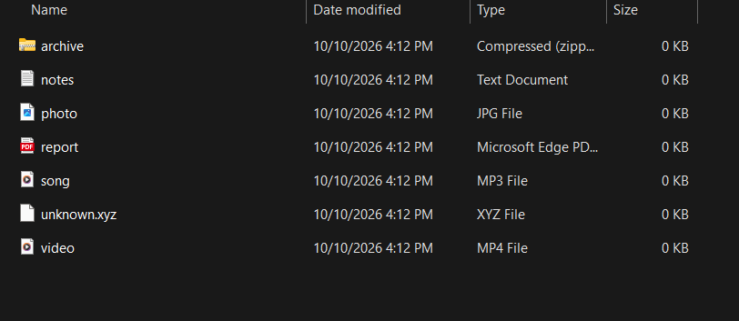
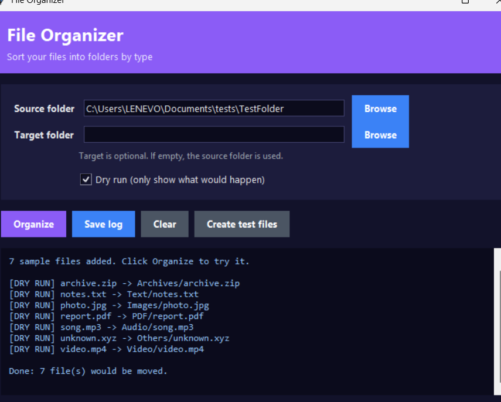
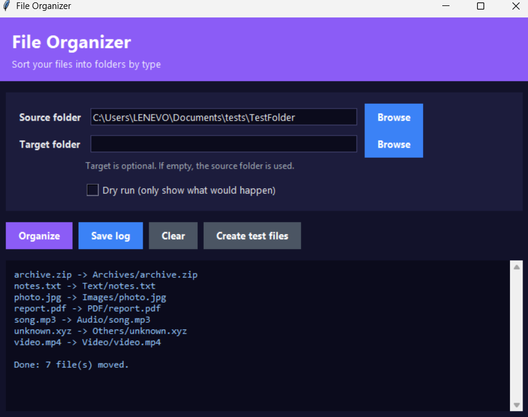
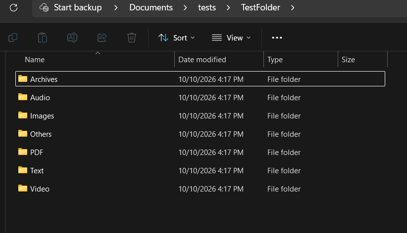

# File Organizer

Sorts files in a folder into subfolders by file type (Images, Documents, Audio, Video, Archives...).

## Features

- Sorts files by extension into category folders
- Never overwrites files: duplicates become `photo (1).jpg`, `photo (2).jpg`
- Configurable source and target folders
- Dry-run mode (shows planned moves without moving anything)
- Graphical interface (tkinter) and command line

## Requirements

Python 3.10+ (no extra libraries needed)

## Usage

### Graphical interface

    python Interface.py

1. Click **Create test files** to generate a sample folder (optional).
2. Click **Browse** and choose the folder to organize.
3. Keep **Dry run** checked to preview, or uncheck it to move files.
4. Click **Organize**. The result appears in the log box.
5. Click **Save log** to export the log.

### Command line

    python organizer.py --dry-run
    python organizer.py C:\path\to\folder
    python organizer.py C:\path\to\folder --target C:\path\to\sorted

## Screenshots

### Before (loose files)

### Dry run (preview, nothing is moved)

### After running (files sorted into folders)

